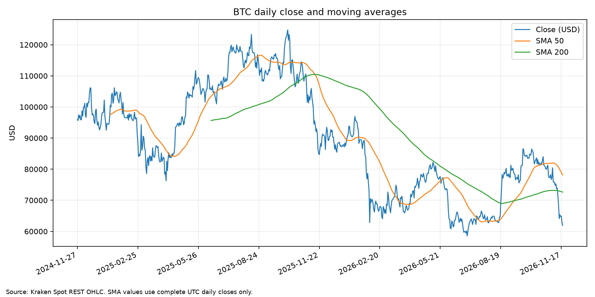
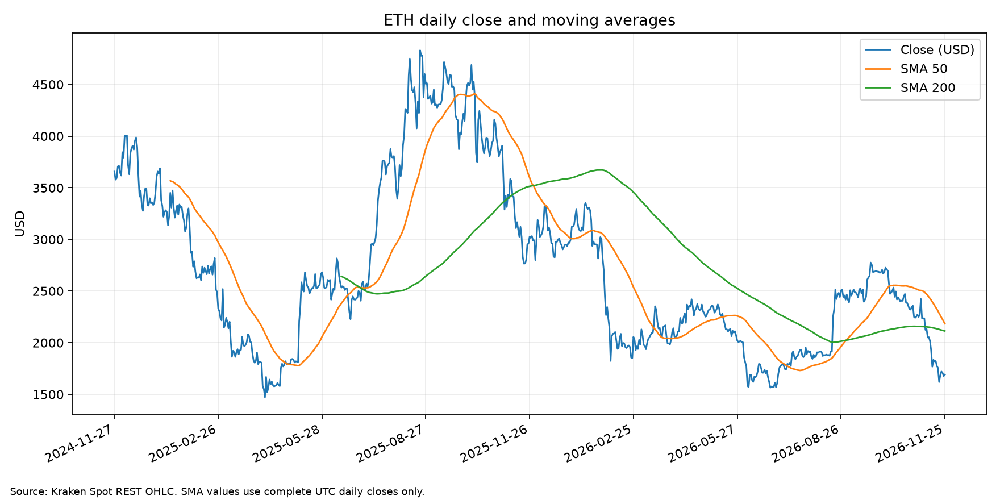
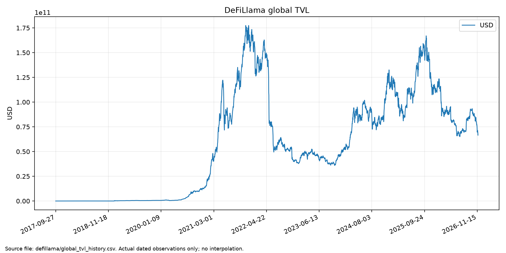
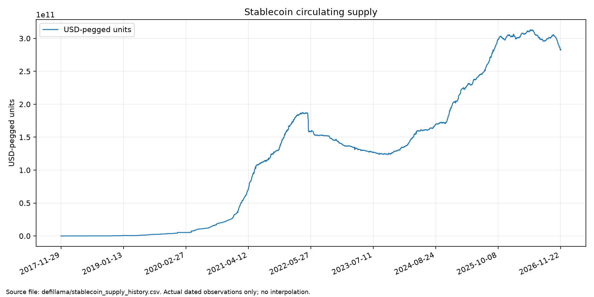
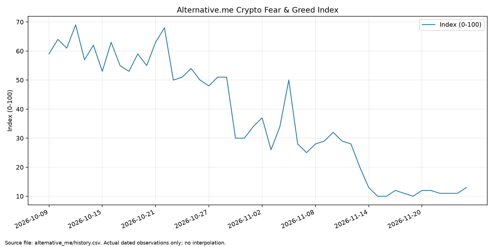
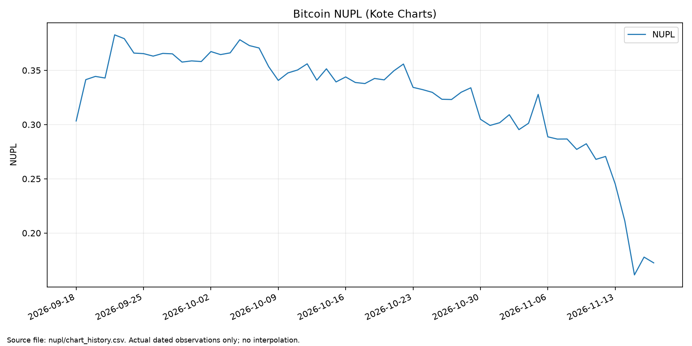
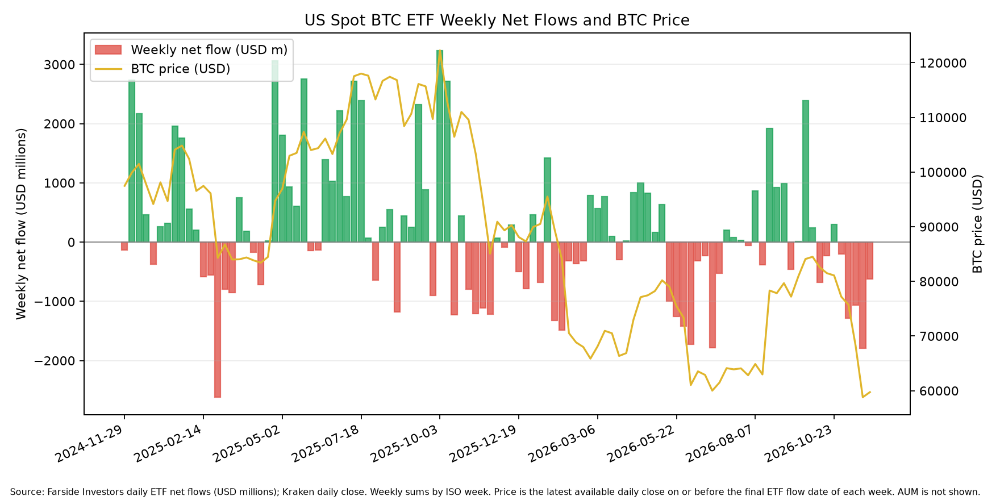
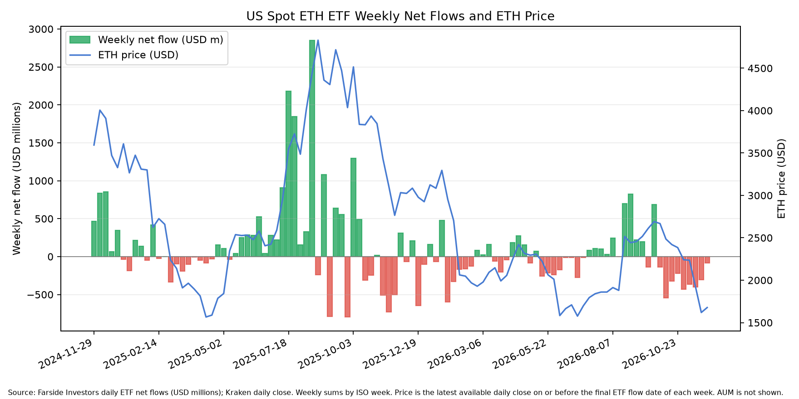

# Crypto Market Chart Assets

Public image assets generated by the private crypto-market data pipeline.

Only rendered PNG images and a minimal manifest are published here. Raw data, reports, research notes, prompts, credentials and pipeline configuration remain private.

Last generated (UTC): 2026-11-25T04:14:32Z

## Charts

### BTC价格与SMA50/SMA200

[Open PNG](https://raw.githubusercontent.com/xiuhu131/crypto-market-chart-assets/main/charts/btc_price_sma.png)

### ETH价格与SMA50/SMA200

[Open PNG](https://raw.githubusercontent.com/xiuhu131/crypto-market-chart-assets/main/charts/eth_price_sma.png)

### DeFiLlama global TVL

[Open PNG](https://raw.githubusercontent.com/xiuhu131/crypto-market-chart-assets/main/charts/defi_global_tvl.png)

### Stablecoin circulating supply

[Open PNG](https://raw.githubusercontent.com/xiuhu131/crypto-market-chart-assets/main/charts/stablecoin_supply.png)

### Alternative.me Crypto Fear & Greed Index

[Open PNG](https://raw.githubusercontent.com/xiuhu131/crypto-market-chart-assets/main/charts/fear_greed.png)

### Bitcoin NUPL (Kote Charts)

[Open PNG](https://raw.githubusercontent.com/xiuhu131/crypto-market-chart-assets/main/charts/btc_nupl.png)

### BTC现货ETF周度净流入与BTC价格

[Open PNG](https://raw.githubusercontent.com/xiuhu131/crypto-market-chart-assets/main/charts/btc_spot_etf_weekly_flows_price.png)

### ETH现货ETF周度净流入与ETH价格

[Open PNG](https://raw.githubusercontent.com/xiuhu131/crypto-market-chart-assets/main/charts/eth_spot_etf_weekly_flows_price.png)

[Machine-readable manifest](manifest.json)
